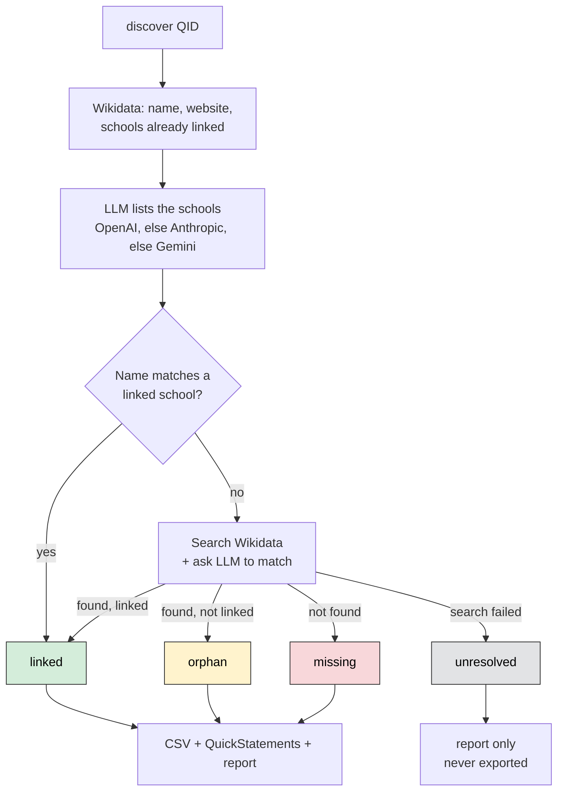
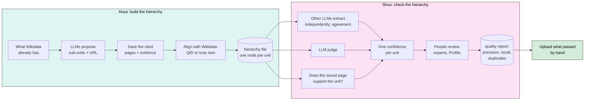
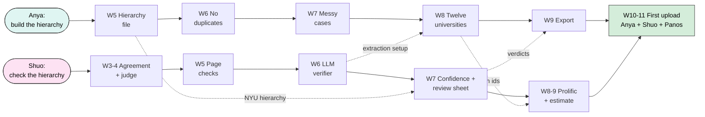

# TASKS.md

**Goal.** Build the structure of every U.S. university (university, then school, then
department) as a hierarchy we keep offline, aligned with Wikidata, with evidence for every
unit. Then measure how good that hierarchy is, with other LLMs, with the evidence, and with
people. Only what passes goes to Wikidata, by hand, at the end.

This file is the plan for Anya and Shuo. You direct a coding agent, and the agent writes
most of the code. Read this file once. Then read your own week each week. The glossary is
in section 12.

Each week here is the short version. The agent builds to the full version in `SPECS.md`,
and it writes the automated tests listed there. You do not have to read `SPECS.md`.

Last updated: 2026-11-04. On that date the schedule moved to match the work done so far.
The week numbers are now names for the steps. Section 4 has the dates.

---

## 1. Where we are (2026-11-04)

**What the code does.** Given a university, `discover` finds its schools and colleges:

```
python -m wikidata_discover.scripts.wikidata_division_discover discover Q49210
```

It looks up the university on Wikidata (Q49210 is NYU). It asks an LLM for the schools.
It compares each school with Wikidata and gives it a label. It writes a CSV, a
QuickStatements file, and a report to `wikidata_discover/results/`.



**Done so far:**

| Step | Who | Result |
|---|---|---|
| School evaluation | before the term | 12 famous universities: about 95% precision and recall (`wikidata_discover/eval/results_summary.csv`) |
| Run `us-tier1` | Oct 3 | 1,519 universities, 9,190 proposed schools: 2,327 linked, 450 orphan, 6,413 missing |
| Run log (week 2) | Anya | BigQuery tables `runs`, `llm_calls`, `evidence`, `candidates`; 40 command runs recorded |
| Wikidata snapshot (week 3) | Anya | 1,519 of 1,519 universities: 20,997 units; 592 universities have no units |
| Gap report and baseline (week 3) | Anya | Of 20 "missing" schools: 1 already on Wikidata, 6 not schools, 1 unclear, 12 really missing |
| Sub-units and page fetcher (week 4) | Anya | `subunits` with web search for all three providers; 16 pages saved for NYU and 3 of its schools |
| Modeling rules, first version (week 4) | Anya | `docs/MODELING_RULES.md`, with open questions for Panos |
| Scorer and department ground truth (week 2) | Shuo | `eval/dept_scorer.py`; 24 departments of Stern, Courant, and Steinhardt |
| Agreement runs (week 3, part) | Shuo | 3 runs on the 12 evaluation universities: 685 rows in a new `checks` table |

**Open items. Do these first.**

- [x] Panos: merge [pull request 22](https://github.com/ipeirotis-org/academiabot/pull/22).
  It brings Anya's week 4 to `master`. Pull request 21 went to another branch by mistake.
  One line conflicts: keep both `beautifulsoup4` and `openpyxl` in `requirements.txt`.
- [ ] Shuo: push the week 3 agreement code and open a pull request. The BigQuery rows name
  commits `3122988` and `ff51783`, and GitHub does not have them. Without them, nobody can
  repeat the run.

**What the numbers tell us.**

- "Missing" means "not found by prefix search". It does not mean "not on Wikidata". The
  week 1 spot check found at least 5 of 40 "missing" schools already on Wikidata. Example:
  "Wheelock College of Education & Human Development" is Q4948183, labeled "Boston
  University Wheelock College ...". Kent State Geauga is on Wikidata twice (Q61931599 and
  Q100993336).
- About 1 "missing" row in 4 is not an academic unit: offices ("Career Services") and
  campuses. The week 1 spot check found about 10 of 40, and the week 3 baseline 6 of 20.
- The 12 evaluation universities are all famous. LLMs do worse on less-known universities
  and on deeper levels (`docs/LITERATURE.md`). Expect lower numbers for small colleges and
  for departments.

**What does not exist yet:**

- A hierarchy file. Today each run writes flat CSVs. (Anya, week 5.)
- A search that finds an existing Wikidata item under another label. (Anya, week 6.)
- The judge test, the page checks, the verifier, confidence, and human review. (Shuo,
  weeks 4 to 9.)
- Any upload to Wikidata. (Both, weeks 10 and 11.)

**Collecting many universities at once.** The batch runner resumes where it stopped and
uploads every output to the `academiabot` bucket under `runs/<run_id>/`. It runs from a
terminal or as a Cloud Function every 30 minutes. AGENTS.md ("Running collection in the
cloud") tells how. Only Panos starts a cloud run, because it spends LLM credit.

Read `docs/BACKGROUND.md` (where the project came from) and `docs/LITERATURE.md` (the
research behind each step) once.

---

## 2. The two tracks



**Anya's output: the hierarchy file.** One file per university, with one node per unit.
Each node has:

- our own stable id (the same unit gets the same id on every run);
- a name, other names, and a type (school, department, program, center, campus, office,
  other);
- its parents (a list, because a joint department has two), and for each parent, whether
  Wikidata already has that link;
- its Wikidata QID, or none, and an alignment status: linked, orphan, new, pending, or
  uncertain (section 12);
- the Wikidata items it was compared with, and why one was chosen or none;
- the evidence: the source URL, and a saved copy of the page with the date it was fetched;
- the run and the LLM calls that proposed it.

AGENTS.md ("Hierarchy file") has the exact field list.

**Shuo's output: checks, reviews, and a quality report.**

- Every automated check of a unit is one row in the `checks` table. Examples: which
  providers named it, what the judge said, whether the page supports it.
- Every human verdict is one row in the `reviews` table.
- Nobody overwrites a row in either table.
- A quality report per run comes from the two tables. It gives precision by level with a
  confidence interval, an estimate of recall, the share of cited pages that support their
  unit, and the duplicate rate.

Each student also owns two research questions (section 8). The weeks below include the
measurements they need.

---

## 3. How we work

You direct a coding agent (Claude Code or similar). The agent reads `AGENTS.md` for the
rules of the code, this file for the short version of your week, and `SPECS.md` for the
full version. You do the part the agent cannot do:

- **Say exactly what to build.** Name your track and week: "Shuo, week 5".
- **Check the result on data you chose.** Run the command. Open the file. Count the rows.
  Never accept "done" without seeing it work.
- **Judge the data.** Is this really a department? Is this URL the right page? The agent
  guesses. You know, or you find out.
- **Own what goes into Wikidata.** The agent never uploads. A person does, after review.

Rules:

1. One week per branch and pull request. Open the pull request against `master`.
2. Ask the agent for a short plan before it writes code. Push back if it does more than the
   week asks.
3. Run the tests yourself: `python -m pytest tests -q`.
4. Push your branch at the end of every session, finished or not. Work that is only in your
   Codespace is lost when the Codespace is deleted.
5. At the end of a session, have the agent tick your boxes in this file, add what it
   learned to `AGENTS.md`, and summarize the change in the pull request.
6. Keep a short log for Panos: the date, what you tried, what worked, what you decided.
7. Bring the "Hand to Panos" item of your week to the weekly meeting.
8. Every number you report says what it was measured on (how many units, which
   universities). From week 5 on, it also has a confidence interval.

Each week below has four parts:

- **Ask the agent to build:** the short version. Give it to the agent with the week name.
- **You check it by:** steps you do yourself. They and the tests in `SPECS.md` are the
  acceptance test. The agent writes those tests; you run them.
- **You do yourself:** the part only a person can do.
- **Hand to Panos:** what you bring to the meeting. Tick its box when you hand it over.

---

## 4. Schedule

| Dates | Anya | Shuo |
|---|---|---|
| Nov 6 to 12 | Week 5: the hierarchy file | Finish week 3, then week 4: the LLM judge |
| Nov 13 to 19 | Week 6: no duplicates | Week 5: does the page exist and name the unit? |
| Nov 20 to 26 (Thanksgiving) | Week 7: the messy cases | Week 6: the LLM verifier |
| Nov 27 to Dec 3 | Week 8: twelve universities | Week 7: confidence and a review sheet |
| Dec 4 to 10 | Week 9: a correct export | Weeks 8 and 9: a Prolific task and its pilot |
| Dec 11 to 17 | Weeks 10 and 11: page first, the first upload, the final report | Weeks 10 and 11: pre-upload check, the first upload, the final report |

Weeks 1 to 4 ran from Oct 2 to Nov 5. Sections 5 and 6 keep a short record of each.

**Week 1, for a new team member.** Do these steps once:

1. Ask the agent to install the dependencies and run the tests. All must pass.
2. Get API keys. In a Claude Code cloud session they come from Secret Manager. Elsewhere,
   copy `env.example` to `.env` and paste at least one key (ask Panos). Never commit `.env`.
3. Run discovery on NYU (Q49210). Open `wikidata_discover/results/reports/Q49210_report.json`.
   (NYU's schools are all linked already, so it gets no CSV. A university with missing
   schools also gets a CSV and a QuickStatements file.)
4. Run it on a university you know well. Is the list of schools right? Note what is wrong.
5. Open 10 rows of `runs/us-tier1/missing_divisions_*.csv` in the bucket, from universities
   you never heard of. Search Wikidata for each "missing" school by hand. Is it really
   missing? Is it really a school?
6. Ask the agent to walk you through `discovery.py`. Then ask it what confused you most.
7. Run the evaluation (`python -m wikidata_discover.eval.run_eval`). Compare its numbers
   with `wikidata_discover/eval/results_summary.csv`.
8. Read `docs/BACKGROUND.md`, and the part of `docs/LITERATURE.md` for your track.
9. Write one paragraph for Panos: what the pipeline does, and one thing you would change.

---

## 5. Anya's track: build the hierarchy

Your question for the semester: **can the code build each university's hierarchy so that
every unit either points to the right Wikidata item or is truly new, and say where each
unit came from?**

### Done: weeks 2 to 4

**Week 2: record everything.** Every run leaves a full record in BigQuery and Cloud
Storage, with local files when GCP cannot be reached. Keys come from Secret Manager. Every
column is explained in `docs/RUN_LOG_SCHEMA.md`.

- [ ] **Hand to Panos:** the table schema on one page, and a screenshot of a real run in
  BigQuery.

**Week 3: what Wikidata already has, and what is missing.** The `snapshot` command, the
import of `us-tier1` into `candidates` (marked "legacy"), and the gap report
(`results/gap_report.csv`). Section 1 has the numbers.

- [x] **Hand to Panos:** the gap report, and your baseline: of 20 "missing" schools, how
  many were not missing, and how many were not schools.

**Week 4: departments, with evidence.** The `subunits` command, the `--provider` option,
the page fetcher with its safety rules, and the first version of `docs/MODELING_RULES.md`.
It reaches `master` with pull request 22.

- [ ] **Hand to Panos:** department lists for the three NYU schools, with the score for
  each.

### Anya, week 5 (Nov 6 to 12): the hierarchy file

**Goal.** One file per university that holds the whole tree, with ids that do not change.

**Ask the agent to build:**

- `discover --depth 2`: one hierarchy file per university, and the same nodes in a `nodes`
  table in BigQuery.
- Every in-scope unit from the week 3 snapshot goes in, even if no LLM named it. It gets
  its departments looked up and its own saved page, as in week 4.
- A register of node ids. A unit keeps its id when it is renamed, moved, or matched to a
  QID.

**You check it by:**

1. Run `discover --depth 2 Q49210`. Open the file.
2. Pick 10 departments at random. Is each under the right school? Is the type right? Is the
   QID right, or rightly empty?
3. Every node has a source URL or a flag.
4. Compare the file with NYU's snapshot. Every in-scope school in the snapshot is in the
   file, with its departments looked up.
5. Run it a second time. Every unit keeps its node id.

**You do yourself:** Note every oddity: a department under two schools, two departments
with the same name, a "school" that is really a program, one unit under two names. These
feed weeks 6 and 7.

- [ ] **Hand to Panos:** NYU's hierarchy file, your list of oddities, and the midpoint
  report: cost and time per university, and the share of units with a saved page.

### Anya, week 6 (Nov 13 to 19): no duplicates

**Goal.** Never call a unit "new" when Wikidata already has it.

**Ask the agent to build:**

- More searches before a unit is called "new": full-text search, the name with the
  university's name in front, other names, the website domain, and items under units
  already in the tree.
- An LLM picks one candidate from the list, or none. Behind a flag, a second way to decide:
  one yes-or-no question per candidate (for research question A1).
- Merge our own nodes that are one unit under two names. When Wikidata has two items for
  one unit, flag it for a person. Never merge on Wikidata.
- Every node records the candidates it looked at and the reason for the choice.

**You check it by:**

1. Every unit in Shuo's ground truth that has a QID now links to that QID. Count the misses.
2. Run the 20 schools of your week 3 baseline again. How many now get the right QID?
3. Run NYU twice. The second run adds no nodes.

**You do yourself:** research question A1 (section 8).

1. Have the agent draw 150 units from `us-tier1` at random: 100 that it called missing,
   and 50 that it called linked or orphan. The agent records the seed.
2. Label each unit by hand: the right QID, or "none". When Wikidata has two items for the
   unit (like Kent State Geauga), write both.
3. Have the agent compute the false-new and false-link rates from your labels, as
   `SPECS.md` says.

- [ ] **Hand to Panos:** the false-new and false-link rates, before and after this week,
  per kind of search and per way to decide. Give them per stratum and overall.

### Anya, week 7 (Nov 20 to 26, Thanksgiving): the messy cases

**Goal.** The code follows `docs/MODELING_RULES.md` for the hard cases.

**Ask the agent to build:** code that applies the rules, with one test per rule:

- A joint department gets two parents, each link with the rank and qualifiers the rules
  set.
- Departments with the same name stay separate.
- Renamed units, campuses, and offices are handled as the rules say.

**You check it by:** Give it the oddities from week 5. Each must come out as the rules say.

**You do yourself:** Finish `docs/MODELING_RULES.md` with Panos. Start with its open
questions. It needs at least 5 real cases, each with the decision and the reason.

- [ ] **Hand to Panos:** the rules doc and the passing tests.

### Anya, week 8 (Nov 27 to Dec 3): twelve universities

**Goal.** Run the full build on all 12 ground-truth universities.

**Ask the agent to build:**

- An `--extract` flag that picks the extraction setup: one provider, or two generators and
  a judge. Set it to the setup Shuo chose in week 6.
- A depth 2 run on the 12 universities, written to the run log, with a summary table per
  university.
- A replay mode. It reuses what was stored with the run, and asks nothing again.

**You check it by:**

1. Pick one university. Recount its summary row by hand from the hierarchy file.
2. Run one university again in replay mode. It must be fast, and the numbers must be
   identical. (A normal rerun can differ, because Wikidata or a page changed. That is
   correct.)

**You do yourself:** Give the run ids to Shuo.

- [ ] **Hand to Panos:** the 12 hierarchy files and the summary table.

### Anya, week 9 (Dec 4 to 10): a correct export

**Goal.** Turn reviewed units into QuickStatements files that Wikidata editors will accept.

**Ask the agent to build:**

- An exporter that reads the hierarchy file and the `reviews` table. It writes one
  QuickStatements file per level, and links with P749, not P361.
- A reference on every statement: the saved page for that fact, with the date retrieved.
- One rule per alignment status. New gets the minimum statement set. Orphan gets only the
  missing P749 statements. Linked gets nothing. Pending waits. Uncertain is never exported.
- Only units accepted on their current version are exported. The rule for what counts as
  accepted comes from `review_protocol.json`.
- A manifest next to each file, and an `ingest-qids` command for the step after a school
  upload.

**You check it by:**

Warning: preview only. Do not run the file in QuickStatements.

1. Paste the file into the QuickStatements web tool in preview mode. Every statement shows
   a reference.
2. Mark 3 rows reject and 2 rows fix (one name, one parent). Export again. The rejected rows
   are absent. The fixed rows wait until you accept their new versions. Then they carry the
   corrections.
3. Delete `review_protocol.json`. The export refuses to run.
4. Open the manifest. It has one line per statement, and a reason for each unit left out.

**You do yourself:** Read every line of the NYU export.

- [ ] **Hand to Panos:** the NYU export file, previewed and accepted by the tool.

### Anya, weeks 10 and 11 (Dec 11 to 17): page first, the first upload, the final report

**Goal.** Test a second way to extract (research question A2), put the first university on
Wikidata, and write the final report.

**Ask the agent to build:**

- First, the fixes the upload needs.
- Then an `--extract page-first` mode. It finds and saves the unit's own page that lists
  its sub-units. It extracts units from that saved text only.
- Last, a cleanup: all tests pass, and the boxes in this file are ticked.

**You check it by:**

1. Do the checks of weeks 5, 6, and 9 again.
2. Run Stern in page-first mode. Every unit cites the one saved page, and its name is in
   the text of that page.
3. Run both modes on the 6 ground-truth schools and score them. Run Shuo's verifier on
   both.

**You do yourself:** the **first upload**, with Shuo and Panos.

Warning: upload only if the result meets the bar in Shuo's `docs/REVIEW_PROTOCOL.md`.

1. Pick the university with the best quality report.
2. Rerun alignment for its schools against today's Wikidata. An editor can have created a
   "new" unit or added a link since week 8. Each changed unit gets a new version.
3. With Shuo, review every school on its current version. The export refuses verdicts on
   older versions.
4. Export the schools. Read every line. Upload under your own Wikidata account. Record the
   batch id in this file.
5. Run `ingest-qids`. Departments under new schools get a new version.
6. Rerun alignment for all its departments against today's Wikidata. Only then review the
   departments.
7. Export and upload the departments the same way.
8. Query Wikidata to confirm the upload (`docs/SPARQL_QUERIES.md`).

Then write your final report, with a two-page note on A1 and A2.

- [ ] **Hand to Panos:** the departments of one university live on Wikidata, or a written
  reason why not yet.
- [ ] **Hand to Panos:** the final report: what the pipeline can do, its numbers, the cost
  per university, the false-new rate, and what the next person should do first.

**Done when:**

- `discover --depth 2` writes a hierarchy file for 12 universities.
- Every unit has a saved source page or a flag.
- Every unit is linked, orphan, new, pending, or uncertain, for a recorded reason.
- The false-new rate is measured.
- The export is correct, and every statement has a reference.
- The departments of one university are live on Wikidata.

**If something is late.** Week 8 needs Shuo's choice of extraction setup (Shuo's week 6,
by Nov 26). If it is late, use Anthropic judging OpenAI plus Gemini, the best setup at the
school level.

---

## 6. Shuo's track: check the hierarchy

Your question for the semester: **for every unit in the hierarchy, how sure are we that it
is right, and which checks are worth what they cost?** You build four kinds of check, in
this order:

1. Other LLMs extract the same list independently, and we count agreement.
2. An LLM judge reviews the merged list.
3. Code checks the saved page against the claim.
4. A person gives a verdict. Nothing enters Wikidata without this one.

### Done: week 2

**Week 2: a scorer.** `wikidata_discover/eval/dept_scorer.py` scores any department list
against an answer key. The answer key for Stern, Courant, and Steinhardt has 24
departments (`wikidata_discover/eval/dept_ground_truth.csv`).

- [ ] **Hand to Panos:** the ground-truth CSV, every row with a URL you visited and a QID
  column. Give it to Anya too.

### Shuo, week 3 (finish Nov 6 to 12): parallel extraction

**Status on 2026-11-04.** Three runs on the 12 evaluation universities are in BigQuery
(685 `checks` rows). The 6 small universities are not in them yet. The code is not on
GitHub yet (section 1).

**Goal.** Find out whether independent LLMs agree, and whether agreement means a school is
real.

**Ask the agent to build:**

- Each provider lists the schools on its own, 3 runs each, for the 12 evaluation
  universities and the 6 small universities. Each run has a sample number in its cache key.
- Name variants of one school are grouped. One `checks` row per proposed school: how many
  providers and runs named it.
- A table: precision at each level of agreement, and how often provider B names a wrong
  school when provider A did. Each provider's invented and non-academic proposals, reported
  separately.
- Research question S1 (section 8): the number of schools at each university, estimated
  from the overlap between providers, next to the true count.

**You check it by:**

1. Run it twice. The numbers must be identical (the cache works).
2. The cache folder has 3 files per provider and university, not 1.
3. Recount two universities by hand from the raw lists. Make one of them small.

**You do yourself:**

1. Build a school-level ground truth for 6 small universities. "Small" means the bottom
   third of `us-tier1` by the number of Wikipedia articles about the university. The agent
   draws the 6 and records the seed.
2. Read 20 schools that only one provider named. Is each one real?

- [ ] **Hand to Panos:** the agreement table, and the first recall estimate next to the
  true count.

### Shuo, week 4 (Nov 6 to 12): the LLM judge, tested

**Goal.** Find out whether an LLM judge helps, and how it is biased.

**Ask the agent to build:**

- Each provider takes a turn as judge of the merged list. Each judge runs four times: twice
  with the list in one order, and twice in another order.
- A report: how often a verdict flips in the same order and between orders; whether a
  judge keeps its own provider's schools more often; whether the judge gains in precision
  or in recall.
- The same test on the departments of the six ground-truth schools, with `--provider`, 3
  runs each.

**You check it by:**

1. Make one list by hand, with 3 fake schools added. Does each judge remove them?
2. The order test runs on all 12 universities. It reports both flip rates: same order and
   different order.

**You do yourself:** Extend the department ground truth to three schools outside NYU: one
at a large public university, one at Howard, and one at a small college. Use the same
columns.

- [ ] **Hand to Panos:** the judge table, and the department ground truth for 6 schools.

### Shuo, week 5 (Nov 13 to 19): does the page exist and name the unit?

**Goal.** Simple, mechanical checks on every saved page.

**Ask the agent to build:**

- First, a new run of each provider with web search on, for the same universities and for
  the departments of the six ground-truth schools. Then Anya's fetcher on every URL that
  each provider cited.
- Four checks on every saved page: a dead link; a page that says "not found" with status
  200; a page off the university's domain; whether the unit's name is on the page.
- The same checks on 300 random school URLs from `us-tier1`, reported separately.
- One `checks` row per result. Search-off and search-on results are reported separately.

Note: nyu.edu answers status 405 to the fetcher on some pages (4 of the 16 pages saved in
week 4). The site refuses the fetcher. That does not mean the page is dead.

**You check it by:** Give it 10 URLs you picked: 2 dead, 2 real but about something else,
and 6 correct. It must sort all 10 as you did.

**You do yourself:**

1. Label 100 claim-and-page pairs ("X is a department of Y", and the saved page):
   supported, not supported, or unclear. The agent draws the pairs, a third per provider,
   and records the draw.
2. Read 20 failures and sort them: dead link, wrong page, right page but different name,
   made-up URL.

- [ ] **Hand to Panos:** the midpoint report: per provider, the share of cited URLs that
  exist and support the unit, with confidence intervals. Also the agreement and judge
  tables.

### Shuo, week 6 (Nov 20 to 26, Thanksgiving): the LLM verifier

**Goal.** An LLM reads the saved page and says whether it supports the claim.

**Ask the agent to build:**

- Input: a claim and the saved page. Output: supported, not supported, or unclear, with a
  quote of the sentence that decides it.
- Long pages are split into pieces that fit the model. If the quote is not in the saved
  page word for word, the answer becomes unclear.
- A cheap second version with MiniCheck, a small checker that answers only yes or no.

**You check it by:**

1. The agent compares the verifier with your 100 labels: accuracy and the confusion matrix,
   per provider.
2. Spot-check 10 quotes against the page.
3. Use one test page that is longer than the model can read at once, with the supporting
   sentence near the end. The answer must be supported.

**You do yourself:**

1. Decide what verifier accuracy is good enough to sort the review sheet by.
2. Choose the extraction setup for departments: which generators, and which judge. Use
   search-on numbers only (`SPECS.md` says how).
3. Give the choice to Anya by Nov 26.

- [ ] **Hand to Panos:** verifier accuracy with the confusion matrix, and the setup choice
  with the numbers behind it.

### Shuo, week 7 (Nov 27 to Dec 3): one confidence per unit, and a review sheet

**Goal.** One confidence per unit, and a sheet that people can review fast and blind.

**Ask the agent to build:**

- One confidence per node, from the checks on its current version only. Start with a simple
  rule, such as "all providers agree and the page supports it" = high.
- A `review` command that writes one row per node, with every value the export would write.
- Two passes. First pass: random order, checks and confidence hidden. Second pass: checks
  shown, doubtful rows first.
- Columns to fill: `verdict` (accept, reject, fix), one `fix_` column per value,
  `url_checked` per page, and `notes`.
- Each verdict is a new row in the `reviews` table. It never overwrites another row.

**You check it by:**

1. Mark 3 rows reject and 2 rows fix (one name; one parent and QID together). Save and
   reopen. Every verdict and every corrected field is still there.
2. A second reviewer's verdict on the same row is a new row.
3. Change the source URL of one reviewed unit in a later run. Its old verdict no longer
   counts, and the unit shows up again as unreviewed.

**You do yourself:**

1. Review NYU's sheet (Anya's week 5 file), and time yourself.
2. Panos reviews the same sheet independently.
3. Compare every disagreement.
4. Did low confidence predict your rejects? Use your first-pass verdicts only, given before
   you saw the confidence.

- [ ] **Hand to Panos:** `docs/REVIEW_GUIDE.md` (one page, written from the
  disagreements), your agreement with Panos, and how well the confidence predicted your
  verdicts.

### Shuo, weeks 8 and 9 (Dec 4 to 10): a Prolific task and its pilot

**Goal.** A paid review task on Prolific, a pilot, and the first quality estimate.

**Ask the agent to build:**

- A Prolific task. Each item is one parent link: the unit's name, one of its parents, and
  the saved page as a picture. The worker answers accept, reject, or fix, and never judges
  the QID.
- One qualification question, gold items, and two versions: one shows the verifier's
  answer, and one does not. Each worker sees one version only. The instructions ask
  workers not to use AI tools.
- A sample of about 150 parent links from Anya's 12-university run, with 3 workers per item
  in each version.
- A script that computes agreement with your verdicts. Then the analyses: worker
  accuracy, Dawid-Skene against a simple majority, the effect of showing the verifier's
  answer, and research question S2 (section 8).

**You check it by:**

1. Do the task yourself as a worker. Ask Panos to do 10 items. Fix every instruction that
   confused either of you.
2. Recompute one reported number by hand from the raw rows.

**You do yourself:**

1. Write 20 gold items. Change units you checked: give one the wrong parent, make up a
   unit, attach the wrong page.
2. Before the launch, label all 150 items yourself, blind, in three parts:
   - **true:** is it a real unit of that parent, by any source you can find? Write "cannot
     tell" when nothing decides it.
   - **supported:** does the saved page show it? Write no when there is no page.
   - **alignment:** is its QID, or "new", right?
3. After the pilot, read every item where workers disagreed.

Budget guide: about 20 cents per unit in the old project.

- [ ] **Hand to Panos:** the task, ready to launch.
- [ ] **Hand to Panos:** the pilot report: accuracy, cost and time per unit, the anchoring
  effect, a go or no-go on scaling, and precision with its interval both ways.

### Shuo, weeks 10 and 11 (Dec 11 to 17): pre-upload check, the first upload, the final report

**Goal.** A last gate that refuses any file that is not exactly what the reviews allow.
Then the first upload, and the final report.

**Ask the agent to build:**

- A pre-upload check. It reads an export file and its manifest. It rebuilds the export
  from the hierarchy file, the reviews, and `review_protocol.json`, and refuses any
  difference.
- It refuses if any current unit has no verdict, or if the share of units accepted without
  correction is below the protocol's minimum.
- Last, a cleanup: all tests pass, and the boxes in this file are ticked.

**You check it by:**

1. Remove one verdict and run it. It must refuse. Restore the verdict. It must accept.
2. Delete one statement's manifest line. It must refuse.
3. Edit one P17 value in the export file by hand. It must refuse.

**You do yourself:**

1. Write `docs/REVIEW_PROTOCOL.md`. It says who reviews what, how many reviewers there are,
   and what agreement is needed. It also sets the minimum share of a university's units
   that must be accepted without correction before upload.
2. Put the same rule in `review_protocol.json`. The export and the pre-upload check both
   read it, so the two files must agree.
3. With Anya, review every unit of the chosen university on its current version: the
   schools first, and the departments after `ingest-qids`.
4. Do the **first upload** with Anya and Panos (section 5, weeks 10 and 11).
5. Watch the uploaded items. If a Wikidata editor changes something, find out why.
6. Write your final report, with a two-page note on S1 and S2.

- [ ] **Hand to Panos:** the protocol, and the first batch on Wikidata with references,
  every one checked by a person.
- [ ] **Hand to Panos:** the final report:
  - a quality report for the 12 universities: precision by level with intervals, estimated
    recall, page-support rate, and duplicate rate;
  - what each check costs and what it catches;
  - what the next person should do first.

**Done when:**

- Every unit in the 12-university run has its checks recorded.
- A reviewer can run the review process from the two docs alone.
- The quality report has intervals.
- Every statement in the first upload has a URL that a person checked.

**If something is late.** Week 4's department part needs pull request 22 on `master`. If
it is late, do schools only that week, and departments in week 5. Week 7 needs Anya's
hierarchy file (Anya's week 5, by Nov 12).
If it is late, build the sheet from the run log's `candidates` rows and switch later.
Weeks 8 and 9 need Anya's 12-university run (Anya's week 8, by Dec 3). If it is late, run
the pilot on the NYU hierarchy.

---

## 7. Where the two tracks meet

| By | From | To | What |
|---|---|---|---|
| Nov 6 | Panos | both | Pull request 22 merged: Anya's fetcher and `--provider` on `master` |
| Nov 12 | Anya | Shuo | NYU's hierarchy file (for Shuo's week 7) |
| Nov 12 | Shuo | Anya | Department ground truth for 3 more schools (Shuo's week 4) |
| Nov 26 | Shuo | Anya | Which extraction setup to use (for Anya's week 8) |
| Dec 3 | Anya | Shuo | Run ids for the 12 universities (for Shuo's weeks 8 and 9) |
| Dec 3 | Shuo | Anya | The `review` command and verdicts in the `reviews` table (for Anya's week 9) |
| Dec 11 to 17 | Both with Panos | Wikidata | The first upload, if it meets the protocol |



Meet together with Panos once a week. Meet each other whenever a hand-off is due.

---

## 8. Research questions

Each student owns two small questions. Each one uses data that the pipeline produces
anyway. The literature has not settled any of them for our kind of data.
`docs/LITERATURE.md` has the references and the full reasoning, and `SPECS.md` has the
exact method. In weeks 10 and 11, write each one up as a two-page note: question, data,
method, result, and what we changed because of it.

### Anya

**A1. How often is a "new" unit already on Wikidata, and what finds it?** (weeks 3 and 6)

- Why it matters: our spot checks found existing items among "missing" schools. In
  knowledge bases built by LLMs, only about a quarter of the entities have an exact-label
  match on Wikidata (Hu et al., GPTKB). Entity linkers mostly ignore types and parents
  (Möller et al.).
- What to measure, on 150 hand-labeled units: the false-new rate (we would create a
  duplicate) and the false-link rate (we would attach the wrong item). Measure both for
  each search method of week 6, and for a choice from a list against a yes or no per
  candidate (Wang et al., COLING 2025).
- This number decides whether Wikidata editors will trust our uploads.

**A2. Ask and cite, or read the page?** (weeks 10 and 11)

- Today the LLM lists units and cites a URL for each. Generative search engines cite pages
  that fully support the claim only about three quarters of the time (Liu, Zhang, Liang
  2023).
- The alternative: find the school's own "departments" page first, and extract units from
  its saved text. Then the evidence exists before the claim (Singhania et al., "Recall Them
  All").
- What to measure, on the 6 ground-truth schools, for both methods: precision, recall, the
  share of units whose page supports them (Shuo's verifier), and cost.

### Shuo

**S1. Can we estimate recall without ground truth?** (weeks 3 to 5)

- Why it matters: we will never have a hand-built list for the 1,519 universities.
- The idea: if two providers find units independently, the overlap of their lists
  estimates how many units exist. This is capture and recapture, as ecologists use to count
  fish (for lists: Trushkowsky et al. 2013).
- The risk: when two LLMs are both wrong, they agree about 60% of the time (Kim et al.,
  ICML 2025). So they tend to miss the same obscure units, and the estimate will be too low.
- What to measure, on the 12 famous and the 6 small universities: the estimate against the
  true count, for two providers, for three, and for repeated runs of one. Also how much the
  correlation biases it.

**S2. How few human labels can certify the hierarchy?** (weeks 8 and 9)

- Why it matters: a check of every unit by hand does not scale.
- The method: prediction-powered inference (Angelopoulos et al., Science 2023). It gives a
  valid confidence interval for precision from a small human sample plus cheap verifier
  labels on everything. The better the verifier, the tighter the interval.
- What to measure, for 50 to 150 human labels: the interval width with and without the
  verifier labels, and how many labels give plus or minus 3 points.
- A second question in the same pilot: do reviewers who see the verifier's answer copy it?
  Studies of LLM-assisted annotation find that they mostly do (Schroeder et al. 2025).
  That would make our precision look better than it is.

**If a question finishes early,** these are good next ones:

- Does web search help most for small universities? (Mallen et al. 2023 predicts yes.)
- Edge F1 against ancestor F1 at the department level: are the errors wrong parents or
  missing units?
- A calibrated threshold that lets high-confidence units skip human review (conformal
  factuality, Mohri and Hashimoto 2024).

---

## 9. Stretch goals (after week 11)

Pick one. You define the rule and check the data; the agent builds the code.

- **Departments at scale.** Run depth 2 over the `us-tier1` list with the batch runner,
  using the setup from week 8 and the alignment from week 6. One combined review sheet,
  sorted by confidence.
- **Faculty linking.** For one department, find the faculty page, extract names and
  titles, match them to existing Wikidata people and ORCID records, and link with P108
  (employer).
- **Review at scale.** If the Prolific pilot says go: a Prolific task per batch, several
  reviewers per row, and agreement recorded with every upload.
- **Beyond the U.S.** Make the country a parameter of `harvest`.

---

## 10. Parked (not now)

Good ideas that are not the bottleneck. Do not start them unless Panos asks.

- Direct Wikidata API writes with a bot account (needs Wikidata bot approval).
- Salary data for public-university faculty.
- Packaging as an installable command, continuous integration, type checking.
- Reconciling the IPEDS institution list against Wikidata.
- Merging duplicate items that are already on Wikidata. We flag them; editors merge.

---

## 11. Reference: SPARQL queries

The queries are in `docs/SPARQL_QUERIES.md`. Paste them into https://query.wikidata.org.

---

## 12. Glossary

- **Wikidata.** A free database of facts that Wikipedia and many others read from. Anyone
  can edit it. We add to it.
- **LLM (large language model).** An AI model that answers text questions, such as GPT,
  Claude, or Gemini.
- **SPARQL.** The query language for Wikidata. `docs/SPARQL_QUERIES.md` has examples to
  paste into https://query.wikidata.org.
- **BigQuery, Cloud Storage, bucket.** Google Cloud services. BigQuery holds our tables.
  Cloud Storage holds files in a "bucket" (ours is `academiabot`).
- **QID.** Wikidata's id for a thing. NYU is Q49210. Stern is Q770467.
- **Property.** Wikidata's name for a kind of fact. P749 means "parent organization".
  P31 means "is a". The ones we use are listed in `AGENTS.md`.
- **Statement.** One fact: item, property, value. "Stern, parent organization, NYU."
- **Reference.** The source attached to a statement: a URL and the date we looked at it.
- **QuickStatements.** A Wikidata tool that takes a text file of statements and adds them
  in bulk. Our exporter writes those files. A person uploads them.
- **Hierarchy file.** Our offline copy of one university's structure: one node per unit,
  with its parent, its QID if it has one, and its evidence.
- **Node, node id.** One unit in the hierarchy file. The node id is our own id for it. It
  stays the same when the unit is renamed, moved, or gets a QID.
- **Node version.** A fingerprint of everything a reviewer sees for a node. If any fact
  changes, the version changes, and the node needs a new review.
- **Manifest.** A list written next to each QuickStatements file. It says which review
  allowed each statement, and why each left-out unit was left out.
- **Alignment.** Deciding, for each unit we found, which Wikidata item it is, or that it
  has none. Done right, we never create a second item for something that exists.
- **Linked, orphan, new, pending, uncertain.** A unit's alignment status. Linked: on Wikidata and
  attached to its parent with P749. Orphan: on Wikidata but without that P749 (even if
  another property connects them). New: not on Wikidata. Pending: on Wikidata, but its
  parent is new and has no QID yet, so it waits until the parent is uploaded.
  Uncertain: we could not tell, so it is never exported.
- **Duplicate.** Two Wikidata items for the same unit. The worst thing we could create.
- **False-new rate.** Of the units we call new, the share that already exist on Wikidata.
- **False-link rate.** Of the units we give a QID, the share given the wrong one.
- **Evidence.** The page that says a unit exists, saved with the date we fetched it.
- **Check.** One automated test of one unit (do providers agree, does the page support
  it). Each is a row in the `checks` table.
- **Verdict.** One person's decision on one unit: accept, reject, or fix.
- **Blind pass.** A review in which the reviewer does not see the machine checks. Only
  blind verdicts count when we measure precision.
- **Agreement.** How many independent providers or runs named the same unit.
- **Judge.** An LLM that reviews a merged list from other LLMs and removes what is not real.
- **Verifier.** An LLM that reads a saved page and says whether it supports a claim.
- **Precision.** Of the units proposed, the share that are real.
- **Recall.** Of the real units, the share that were found.
- **Edge F1, ancestor F1.** Two scores for a hierarchy. Edge F1 gives credit only for the
  exact parent. Ancestor F1 also gives credit for a correct higher level (the right
  university, but the wrong school).
- **Confidence interval.** The range a number probably lies in, given how few units we
  checked. "Precision 0.93, between 0.89 and 0.96" can be acted on; "0.93" alone cannot.
- **Capture and recapture.** Estimating how many things exist from how much two
  independent lists overlap. Little overlap means many things neither list found.
- **Ground truth.** The correct answer, built by hand, that we score against.
- **Seed.** The start number for a random draw. If you record it, someone else can repeat
  the same draw.
- **Stratum.** One group in a sample that is drawn group by group. Week 6 has two strata:
  units called missing, and units called linked or orphan.
- **Cache.** Stored LLM answers. A second run reads the stored answer and does not pay
  for a new call.
- **Gold item.** A review item whose right answer we know, mixed in to check reviewers.
- **Run log.** Our record of everything a run did: every LLM call, every page fetched,
  every unit proposed. Lives in BigQuery and Cloud Storage.
- **Provider.** An LLM company: OpenAI, Anthropic, Google (Gemini).
- **Prolific.** A website where we pay people to do short review tasks.
